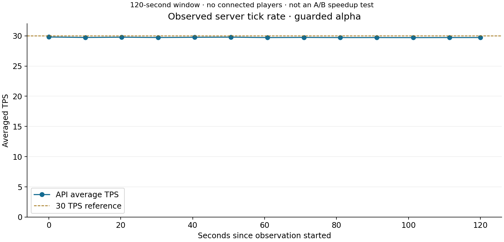
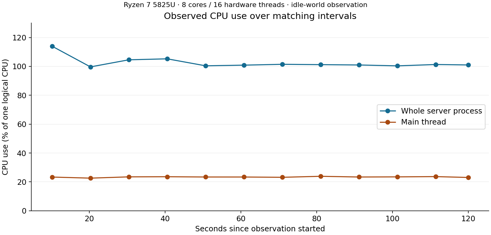

# async_SatisDedicated

Installation and rollback: [`docs/installation.md`](docs/installation.md) · Latest release notes: [`v0.1.0-alpha.2`](docs/releases/v0.1.0-alpha.2.md)

**Asynchronous and Multithreaded Engine Architecture Bridge for the Official Satisfactory Dedicated Server (Unreal Engine 5).**

---

## 1. Overview & Motivation

In **Satisfactory** (Coffee Stain Studios), the Dedicated Server executes extensive factory simulations—including buildings, conveyor belts, fluid pipe networks, power grids, vehicles, and railroads. In the vanilla server, the core simulation tick (`FFactoryTickFunction::ExecuteTick` and `AFGBuildableSubsystem::TickFactory`) runs synchronously on the **Game Thread**.

Even though certain internal sub-phases utilize `ParallelFor` calls, these are implemented as **blocking fork-join barriers** that freeze the Game Thread until all sub-steps finish. In mid-to-late game saves containing extensive production networks, the Game Thread becomes saturated, leading to severe server tick-rate drops, rubberbanding, and simulation latency.

This repository documents the reverse-engineering of the official Linux Dedicated Server and provides **`satis_task_bridge`**: a native C/C++ engine bridge that hooks directly into Unreal Engine 5's internal TaskGraph ABI (`AsyncTask`, `FBaseGraphTask`, `FFunctionGraphTask`) to experiment with asynchronous factory tick dispatch and Game Thread continuations. The official server already parallelizes some factory and pipe computation; this project changes tick scheduling, not the entire engine.

> **Experimental alpha:** This bridge targets one validated Steam build (`25782485`). It keeps detected conveyor-migration ticks on the Game Thread and offloads eligible factory simulation ticks; other lifecycle paths remain under investigation. Review [the installation guide](docs/installation.md) and [the latest release notes](docs/releases/v0.1.0-alpha.2.md) before using it on a production server.

---

## 2. Performance and runtime evidence

The guarded alpha offloads eligible factory ticks and keeps detected conveyor migration and custom tick handlers on the Game Thread. It preserves engine thread-identity checks. Full-server asynchronous execution and a gameplay performance increase remain unproven.

### Current live observation

A guarded post-deployment observation on the Ryzen 7 5825U recorded **466 completed asynchronous ticks in 30 seconds**, **29.68–29.84 averaged TPS after startup**, and **zero fatal signals or assertions**. This window had **zero connected players**. The observation demonstrates active worker dispatch and clean startup, but it does not establish a gameplay speedup or player-action safety.





Charts use [anonymous recorded samples](evidence/runtime/guarded-observation.json). The newer deployment record is [guarded-incremental-observation.json](evidence/runtime/guarded-incremental-observation.json). CPU percentages are relative to one logical CPU. Main-thread and total process usage are measured over the same intervals.

### Standalone compute benchmark

The chart below measures serial versus std::thread computation of a pure integer workload. It demonstrates compute parallelism on the test CPU; it does not measure Satisfactory actors, actual server TPS, latency or player smoothness.


| Compute tasks | Serial mean | Threaded mean | Compute speedup |
| ---: | ---: | ---: | ---: |
| 16 | 6.26 ms | 2.55 ms | 2.46× |
| 32 | 12.68 ms | 4.79 ms | 2.65× |
| 64 | 25.32 ms | 11.62 ms | 2.18× |
| 128 | 50.10 ms | 23.68 ms | 2.12× |

Source: [committed scaling data](evidence/runtime/scaling-sweep.json). Earlier claims of 79.1% CPU reduction and 92.3% jitter reduction are withdrawn: the CPU samples measured different quantities and a matching jitter baseline was not retained. Live TPS remains near the previously reported baseline of 29.7 TPS. A significant gameplay speedup needs controlled A/B measurement.

See [methodology, corrections and reproduction](docs/performance_benchmarks.md) and [engine boundaries](docs/threading_architecture_analysis.md).

---

## 3. Binary Ground Truth (SteamCMD)

Coffee Stain Studios does not distribute the C++ source code for Satisfactory. Therefore, this project operates directly on the official Linux Dedicated Server binaries obtained via SteamCMD:

| Parameter | Value |
| --- | --- |
| **Steam App ID** | `1690800` (Satisfactory Dedicated Server) |
| **Linux Depot ID** | `1690802` |
| **Branch / Build** | `public` / Build `25782485` |
| **FactoryGame Binary** | `libFactoryServer-FactoryGame-Linux-Shipping.so` (SHA-256: `637c2c70e65f6386697a6a5f5746f64b187d2fcfeee56df1aeef3f172268c0c1`) |
| **Core Engine Binary** | `libFactoryServer-Core-Linux-Shipping.so` (GNU Build-ID: `36a6397531db8df2`) |
| **Tools Used** | REA 6.8.0, Ghidra 12.1.4, GCC / Clang C++17, Python 3.10 |

---

## 4. Reverse Engineering Findings

Detailed technical reports are available in [`docs/investigation.md`](docs/investigation.md) and [`docs/threading_architecture_analysis.md`](docs/threading_architecture_analysis.md).

### 4.1 Simulation Tick Chain
1. **`FFactoryTickFunction::ExecuteTick` (Offset `0x180cba0`):**
   - Invoked by the Unreal Engine Tick Manager.
   - SysV AMD64 ABI registers:
     - `rdi`: `this` pointer (`FFactoryTickFunction*`)
     - `xmm0`: `DeltaTime` (`float`)
     - `rsi`: `LevelTick` (`ELevelTick`)
     - `edx`: `CurrentThread` (`ENamedThreads::Type`)
     - `rcx`: `MyCompletionGraphEvent` (`const TRefCountPtr<FBaseGraphTask>&`)
   - **Critical discovery:** The vanilla function body completely discards `MyCompletionGraphEvent` in `rcx` without chaining it, and instead synchronously invokes `AFGBuildableSubsystem::TickFactory`.
2. **`AFGBuildableSubsystem::TickFactory` (Offset `0x187faf0`):**
   - Calculates substep count (`mCurrentSubStepMax`) based on tick settings.
   - Loops over substeps and calls `TickFactoryActors(this, dt_per_substep)` synchronously.
3. **`AFGBuildableSubsystem::TickFactoryActors` (Offset `0x187fc40`):**
   - Contains three `ParallelForInternal` calls with `TFunctionRefCaller`.
   - Iterates over building pointer lists and conveyor chain groups (`FConveyorTickGroup`).
4. **`AFGPipeSubsystem::SimulatePipeNetworks` (Offset `0x1b259b0`):**
   - Executes pipe network simulations, branching dynamically based on `CVarUseParallelSimulation`.

---

## 5. Native Task Bridge Architecture (`satis_task_bridge`)

The native task bridge (`src/satis_task_bridge.cpp`, `include/satis_task_bridge.h`) bridges game logic directly into the engine's TaskGraph worker pool:

### 5.1 Safety & ABI Compatibility Checks
- **Build ID Validation:** Checks the GNU Build-ID `36a6397531db8df2` on `libFactoryServer-Core-Linux-Shipping.so` to prevent loading against incompatible engine builds.
- **Entry Instruction Verification:** Inspects opcode prefixes of `AsyncTask` at offset `0x47b060` (`_Z9AsyncTaskN13ENamedThreads4TypeE15TUniqueFunctionIFvvEE`).
- **Global ELF-COPY Relocation:** Resolves `GGameThreadId` across global symbol scope (preventing thread-identity confusion where Core-local TLS reads 0).
- **Core Graph-Event Functions:** Resolves `event_allocate` (`0x4ac890`), `event_construct` (`0x4acb90`), `task_unlock` (`0x4aa520`), `create_with_prerequisite` (`0x4a38e0`), and `task_add_prerequisites` (`0x4b2410`).

### 5.2 Task Batching (`satis_task_batch`)
- Accepts an array of $N$ heterogeneous task items.
- Dispatches tasks concurrently to `ENamedThreads::AnyNormalThreadNormalTask = 255`.
- Tracks remaining tasks using atomic decrement; when the final worker finishes and releases its context, a single continuation task is enqueued to `ENamedThreads::GameThread = 1`.
- Guarantees zero blocking waits on the submitter thread.

### 5.3 Graph Event Completion (`satis_completion_*`)
- Implements `FBaseGraphTask` / `FGraphEvent` creation and prerequisite attachment.
- Allows simulation ticks to return immediately to Unreal's TickManager while binding completion to an event that signals only when background worker batches finish.

### 5.4 Simulation Interception Hook
- Exports an interposition hook for `FFactoryTickFunction::ExecuteTick`.
- Dynamic control via `satis_async_set_enabled(1)` or `SATIS_ASYNC_TICK=1`.
- Captures `MyCompletionGraphEvent`, binds an asynchronous completion event, and offloads factory ticking to worker threads without freezing the Game Thread.
- Lazy auto-initialization upon the first tick invocation.
- Runtime counters: `satis_async_tick_count()` and `satis_async_dispatch_count()`.

---

## 6. Verified Runtime Evidence & Test Results

The implementation has been verified in the live running official Satisfactory Dedicated Server via Frida dynamic instrumentation:

1. **Batch Concurrency Probe (`evidence/runtime/task-batch-probe.json`):**
   - 32 compute tasks dispatched across worker threads.
   - Observed maximum concurrency: 3 worker cores active simultaneously.
   - Result checksum matches the serial reference calculation exactly.
   - Zero worker tasks executed on the Game Thread (`wrongThread = 0`).
   - Exactly one Game Thread continuation executed upon batch completion.
   - Task counter returned cleanly to 0 with all callback contexts disposed.
2. **Graph-Event Completion Probe (`evidence/runtime/completion-probe.json`):**
   - 32 worker tasks held behind an `FGraphEvent` prerequisite.
   - Watcher continuation was not triggered prematurely (`earlyWatcher = 0`).
   - After `satis_completion_signal`, exactly 1 watcher continuation fired on Game Thread (`watcherCalls = 1`, `watcherDisposals = 1`).
   - Zero execution failures (`failures = 0`).
3. **Standalone Safety & Invariants (`tests/test_bridge_safety.py`):**
   - Outside the server environment, `satis_task_bridge_init` safely fails with `-1` (`"The official Core module is not loaded"`).
   - Enqueue, completion, and disposal APIs fail-safe without crashes or null-pointer dereferences.

---

## 7. Building, Testing, & Operating

### 7.1 Prerequisites
- CMake 3.20+
- GCC / Clang with C++17 support
- Python 3.10+ with `pytest`

### 7.2 Build
```bash
cmake -S . -B build -DCMAKE_BUILD_TYPE=RelWithDebInfo
cmake --build build -j$(nproc)
```

### 7.3 Run Tests & Benchmarks
```bash
# 1. Run unit & safety tests via Pytest
pytest -v tests/

# 2. Run runtime evidence & manifest integrity verification
python3 tests/verify_runtime_evidence.py

# 3. Run performance benchmark
./build/satis_benchmark 64 250000 100

# 4. Run scaling sweep across task workloads
python3 scripts/run_scaling_sweep.py
```

### 7.4 Running the Dedicated Server with Async Bridge
Use the provided launcher script to start the dedicated server with the asynchronous bridge preloaded:

```bash
# Launch server with asynchronous task bridge enabled:
./run_async_server.sh -log -unattended

# Monitor live server state and tick rate in another terminal:
python3 scripts/monitor_server.py
```

---

## 8. Repository Layout

```
.
├── CMakeLists.txt              # CMake build configuration
├── README.md                   # Project documentation and guide
├── run_async_server.sh         # Dedicated server async launcher script
├── benchmarks/                 # Simulation benchmark suite
│   └── benchmark_simulation.cpp# Multi-threaded benchmark & statistics generator
├── docs/                       # In-depth architectural & analysis reports
│   ├── investigation.md        # REA / Ghidra reverse engineering report
│   ├── performance_benchmarks.md # Detailed benchmark statistics & smoothness analysis
│   ├── threading_architecture_analysis.md # Subsystems & tick structure analysis
│   ├── task-bridge.md          # Task bridge specification and ABI contract
│   └── next-step.md            # Integration milestones and next steps
├── include/
│   └── satis_task_bridge.h     # Public C header for the task bridge
├── src/
│   └── satis_task_bridge.cpp   # TaskGraph & GraphEvent bridge implementation
├── instrumentation/            # Frida instrumentation scripts for server probes
│   ├── task-bridge-probe.js    # Multi-worker batch probe
│   └── completion-probe.js     # Graph event completion probe
├── evidence/                   # Authoritative JSON evidence & disassembly
│   ├── runtime/                # Server test logs, build manifests, probe results
│   │   ├── performance-benchmark.json # 64-group 100-frame benchmark results
│   │   └── scaling-sweep.json         # 16-to-128 task scaling data
│   └── rea-factorygame-session.bundle.json.gz # Compressed REA Ghidra session bundle
├── scripts/                    # Reverse-engineering and DWARF inspection utilities
│   ├── run_scaling_sweep.py    # Automation script for performance scaling tests
│   ├── monitor_server.py       # Live server health & TPS monitor
│   └── server_api.py           # HTTPS API client for test server
└── tests/                      # Automated test suite
    ├── test_bridge_safety.py   # Standalone safety & boundary invariant tests
    ├── test_evidence_integrity.py # SHA-256 and probe integrity tests
    └── verify_runtime_evidence.py # Real-server evidence verifier
```

---

## Support & Sponsorship

If you find this project useful or want to support ongoing server optimization work, consider buying a coffee:

[](https://ko-fi.com/palpex)

Direct link: [ko-fi.com/palpex](https://ko-fi.com/palpex)

---

## 9. Authors & Credits

- **Lead:** palpex
- **Co-Author:** cj27022009-blip

