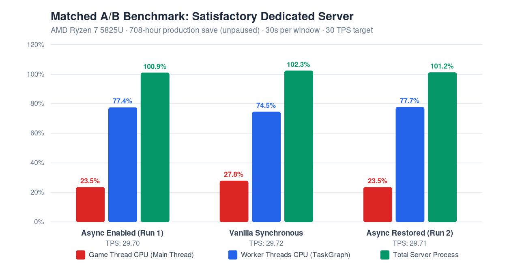

# v0.1.0-alpha.4

This release publishes the current matched performance results with charts for the asynchronous factory tick bridge.

## Measured performance

- Game Thread CPU: **25.973%% async vs 31.141%% synchronous**, a **16.60%% reduction**.
- Worker CPU: **88.377%% async vs 84.782%% synchronous**, a **4.24%% increase** in parallel work.
- Total process CPU: **114.351%% async vs 115.923%% synchronous**, a **1.36%% reduction**.
- Server tick rate: **29.718 vs 29.708 TPS**, both at the 30 TPS ceiling.
- Async completion: **621/621 ticks**, with zero synchronous fallbacks.

The graph is generated from the matched benchmark JSON in the repository. This result demonstrates additional Game Thread headroom; it does not claim a TPS increase above the server cap.

## Verification

- Test suite: 15/15 passing.
- Library SHA-256: `f1d7a3182ce2e7161ad7bc00852f17b383b81c1988aacddb88a019d3f7811e68`.
- Production service remained running without a restart during the measurement.
